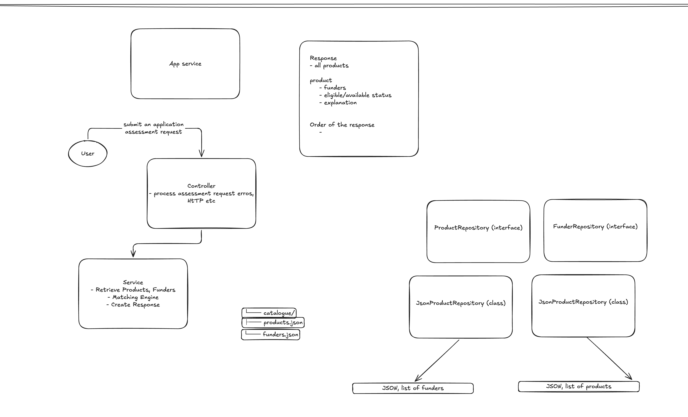
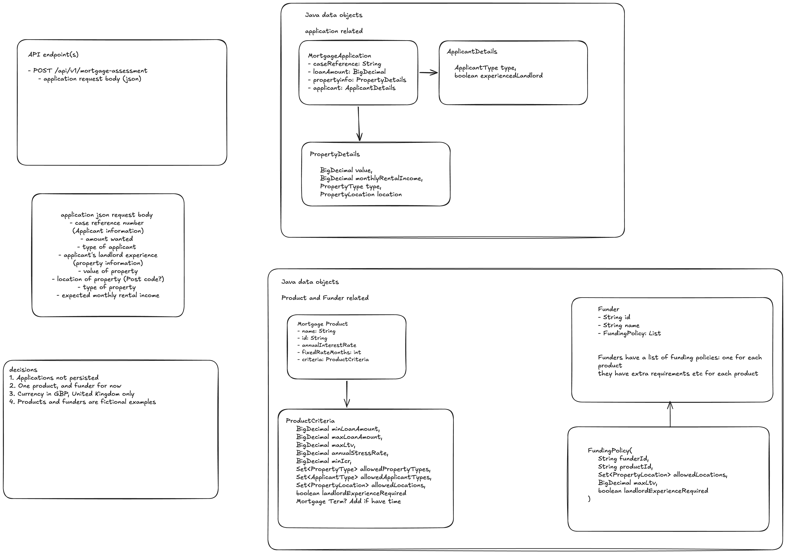

# Mortgage Matcher

Mortgage Matcher is a Spring Boot API that assesses a buy-to-let mortgage case against a catalogue of mortgage products and funder policies. It returns product eligibility, funder availability, and the reasons for any rejection.

This repository contains the Java application, Gradle build, Dockerfile, JSON catalogues, and automated tests. Products are loaded from `src/main/resources/catalogue/products.json`; funders and their policies are loaded from `src/main/resources/catalogue/funders.json`.

## Build and run

Build and run with Docker:

```bash
docker build -t mortgage-matcher .
docker run --rm --name mortgage-matcher -p 8080:8080 mortgage-matcher
```

The Docker build runs `clean test bootJar` and copies the resulting `app.jar` into a Java 21 runtime image. The application has no `server.port` setting, so it listens on Spring Boot's default port, 8080.

Alternatively, you can run locally without containerisation. Requires Java 21. The Gradle wrapper uses Gradle 9.8.1.

Build and run the packaged application:

```bash
./gradlew clean build
java -jar build/libs/app.jar
```

For local development, run directly with Gradle:

```bash
./gradlew bootRun
```

## API

### Mortgage assessment

```javascript
POST /api/v1/mortgage-assessment
Content-Type: application/json
```

Example request:

```json
{
  "caseReference": "CASE-001",
  "loanAmount": 225000,
  "propertyDetails": {
    "value": 300000,
    "expectedMonthlyRentalIncome": 1500,
    "type": "STANDARD",
    "location": "ENGLAND"
  },
  "applicantDetails": {
    "type": "INDIVIDUAL",
    "isExperienced": true
  }
}
```

Representative response:

```json
{
  "caseReference": "CASE-001",
  "products": [
    {
      "productId": "STANDARD_65",
      "productName": "Standard Buy-to-Let 65",
      "eligible": false,
      "available": false,
      "reasons": ["LTV exceeds the product maximum"],
      "funders": []
    },
    {
      "productId": "STANDARD_75",
      "productName": "Standard Buy-to-Let 75",
      "eligible": true,
      "available": true,
      "reasons": [],
      "funders": [
        {
          "funderId": "HORIZON",
          "funderName": "Horizon Lending Fund",
          "available": true,
          "reasons": []
        }
      ]
    },
    {
      "productId": "HMO_70",
      "productName": "Specialist HMO 70",
      "eligible": false,
      "available": false,
      "reasons": [
        "LTV exceeds the product maximum",
        "Property type is not supported by this product",
        "Rental income does not meet the product's stress test"
      ],
      "funders": []
    },
    {
      "productId": "MULTI_UNIT_65",
      "productName": "Specialist Multi-Unit 65",
      "eligible": false,
      "available": false,
      "reasons": [
        "LTV exceeds the product maximum",
        "Property type is not supported by this product",
        "Rental income does not meet the product's stress test"
      ],
      "funders": []
    },
    {
      "productId": "PRODUCT-1",
      "productName": "Product PRODUCT-1",
      "eligible": true,
      "available": true,
      "reasons": [],
      "funders": [
        {
          "funderId": "PASSING-FUNDER",
          "funderName": "Passing Funder",
          "available": true,
          "reasons": []
        },
        {
          "funderId": "STRICT-FUNDER",
          "funderName": "Strict Funder",
          "available": false,
          "reasons": ["LTV exceeds the funder's maximum"]
        }
      ]
    }
  ]
}
```

The request requires a non-blank `caseReference`, a positive `loanAmount`, positive property value and rental income, supported enum values, and a non-null `isExperienced` flag. The current catalogue contains products `STANDARD_65`, `STANDARD_75`, `HMO_70`, `MULTI_UNIT_65`, and `PRODUCT-1`, plus funders `NORTHSTAR`, `HORIZON`, `SPECIALIST`, `PASSING-FUNDER`, and `STRICT-FUNDER`.

Springdoc OpenAPI is included. When the application is running, open [Swagger UI](http://localhost:8080/swagger-ui/index.html); `/swagger-ui.html` is also supported as the conventional redirect URL.

## Repository structure

```text
src/main/java/com/kyan/mortgagematcher/
├── controller/          HTTP endpoints and validation error handling
├── api/dto/              mortgage assessment request and response records
├── service/assessment/   request mapping, catalogue orchestration, and availability rules
├── model/                applicant, property, product, and funder records
└── repository/           repository interfaces and JSON-backed implementations
src/main/resources/catalogue/
├── products.json         mortgage products and product criteria
└── funders.json          funders and product funding policies
docs/
├── design1.png           application flow, response shape, and repository design
├── design2.png           API request, DTOs, domain model, and design decisions
└── COMMIT_CONVENTIONS.md commit message conventions
src/test/                 controller, service, evaluator, repository, and context tests
```

`ProductEligibilityEvaluator` checks loan amount, LTV, property type, applicant type, location, landlord experience, and rental-income stress criteria. `FunderEligibilityEvaluator` checks a funder's location, LTV, and experience policy. An eligible product is available only when at least one matching funder policy accepts it.

### Design documents



_Design 1 shows the request flow from the user through the controller and assessment service, the product and funder repository interfaces, the JSON catalogues, and the shape of the assessment response._



_Design 2 describes the assessment endpoint and request fields, the application and property DTOs, the product and funder domain objects._

## Tests

Run the test suite with:

```bash
./gradlew test
```

or target an individual test class, for example:

```bash
./gradlew test --tests "MortgageAssessmentServiceTest"
```

The tests cover:

- **Controller:** successful requests, bean-validation failures, and malformed JSON responses.
- **Service:** catalogue order, product and funder availability, missing policies, and skipping funder evaluation for ineligible products.
- **Evaluators:** inclusive loan bounds, precise LTV boundaries, supported property/applicant/location values, landlord experience, rental stress, and multiple rejection reasons.
- **Repositories:** loading both JSON catalogues, finding known IDs, and handling unknown IDs.
- **Application:** Spring context startup.
